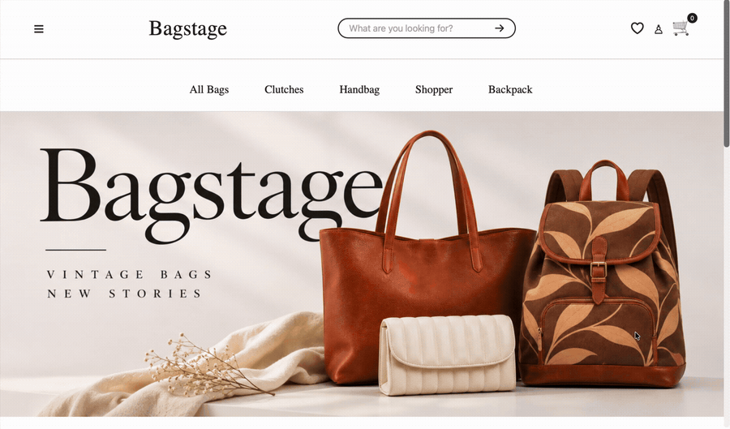
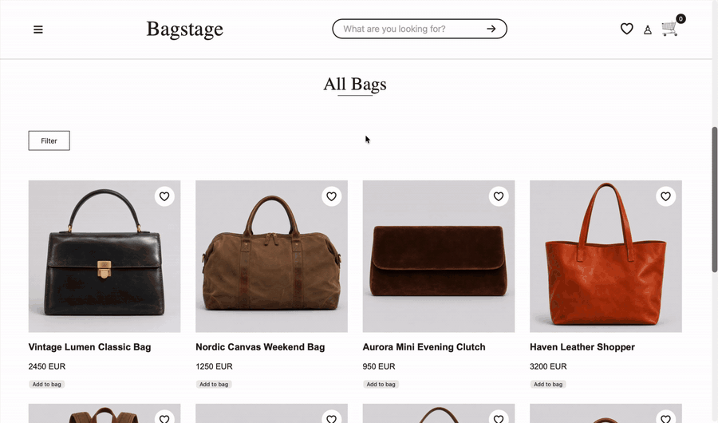

# Bagstage

**A vintage designer handbag e-commerce concept**

Bagstage is a web application for browsing second-hand designer handbags. The project was developed as part of the Web Development course at Jönköping University, together with a project partner.

The goal was to build a complete web application with a frontend, backend and database, where users can create accounts, log in and interact with stored data through asynchronous communication between the client and server.

> **Note:** This is a university project, not a real online store. No actual purchases can be made. Brand names are used as example data, and all product images are AI-generated.

## Demo

Explore the main features and user flows of Bagstage through the demos below.

### User authentication

### Product browsing, search and filtering

### Saving favourite products

## Features

- **Product catalogue** – Browse a collection of second-hand designer bags.
- **Search and filtering** – Find products by brand, category, colour, price and condition.
- **User accounts** – Register, log in.
- **Session handling** – Maintain logged-in sessions using cookies.
- **Favourites** – Save products to a personal favourites list.
- **Admin functionality** – Add, edit and remove products through admin access.

## Tech Stack

| Frontend - HTML, CSS, JavaScript |
| Backend - Node.js, Express |
| Database - MySQL / MariaDB |
| Communication - Fetch API, asynchronous requests |
| Authentication - Sessions, cookies, bcrypt |

## My Contribution

I worked on several parts of the application, with a particular focus on the product experience, visual design and backend functionality.

My main contributions were:

- Established the foundation for the overall design and visual direction of the website.
- Built the product cards and dynamic product presentation.
- Developed the search and filtering functionality.
- Created the CSS and visual styling for the parts I worked on.
- Designed and implemented the database.
- Developed the server-side functionality for handling products.
- Contributed to the development of other parts of the application.

The project was developed collaboratively, and I also gained experience working with the application as a whole, from the database to the frontend.

## How It Works

Bagstage uses a client-server architecture.

1. The frontend sends requests to the Express server using the Fetch API.
2. The server handles requests and communicates with the MySQL/MariaDB database.
3. The database stores information such as products, users and favourites.
4. The server returns data to the frontend.
5. JavaScript updates the page dynamically without requiring a full page reload.

## Run Locally

To run the project locally, you need Node.js and a running MySQL/MariaDB server.

1. Clone the repository.
2. Install the project dependencies: npm install
3. Create the database by running `database.sql` in MySQL/MariaDB. The database is named `bagstage`.
4. Create a `.env` file based on `.env.example` and add your own database configuration.
5. Start the server: node server.js
6. Open the local address shown by the server in your browser.

**Note:** The database server must be running, and the database credentials in `.env` must match your local setup.

## What I Learned

Through this project, I gained practical experience in:

- Building a full-stack web application using frontend, backend and database technologies.
- Working with Express routes and handling HTTP requests.
- Connecting a Node.js server to a MySQL/MariaDB database.
- Using cookies and sessions to handle user authentication.
- Hashing passwords securely with bcrypt.
- Using asynchronous JavaScript and the Fetch API to exchange data between the frontend and backend.
- Writing database queries based on search and filtering criteria.
- Dynamically creating and updating HTML elements using DOM manipulation.
- Structuring and connecting different parts of a larger web application.

## Project Context

Course: Web Development  
University: Jönköping University  
Project type: Collaborative university project  
Purpose: Educational project